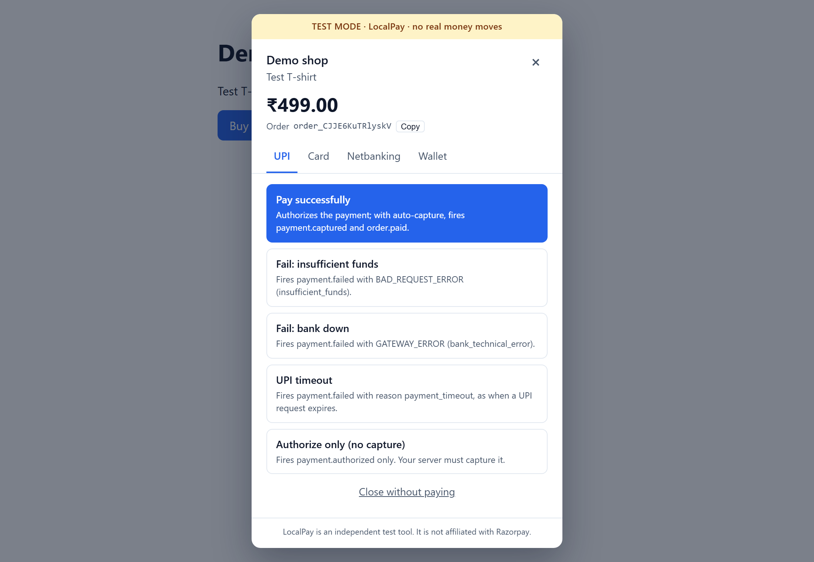
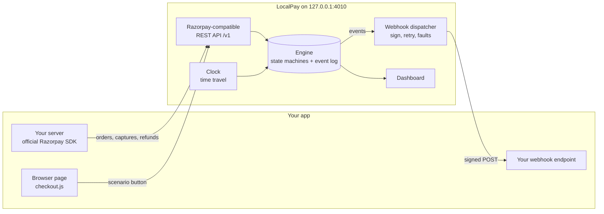
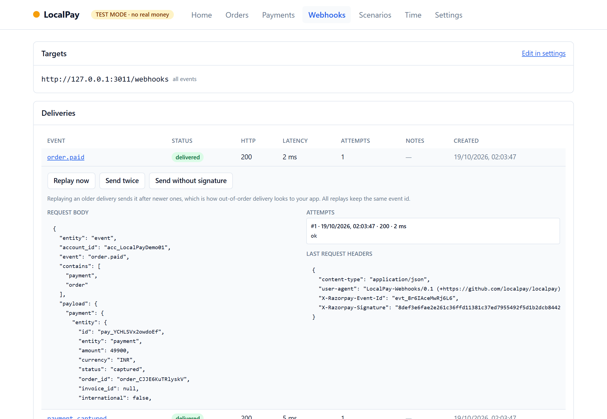

# LocalPay

**Test your Razorpay integration offline. No keys, no ngrok, every edge case one click away.**

[](https://github.com/karthikrshet/localpay/actions/workflows/ci.yml)
[](https://www.npmjs.com/package/localpay)
[](LICENSE)

<a href="docs/assets/localpay-demo.mp4"></a>

<sub>▶ The preview is silent. Click it for the full 1080p video with sound
(<a href="docs/assets/localpay-demo.mp4">localpay-demo.mp4</a>, 23 s).</sub>

## What is LocalPay?

LocalPay is a free, open-source server that behaves like the Razorpay API on your own
machine. Your app keeps using the official Razorpay SDK and checkout code. You point them
at `http://127.0.0.1:4010` instead of Razorpay, and LocalPay handles the rest:

- creates orders and payments, captures them and refunds them;
- opens a **test checkout popup** where each button is an outcome: pay, insufficient
  funds, bank down, UPI timeout, authorize only;
- sends **signed webhooks** straight to `localhost`, with retries, replay and fault
  injection (duplicates, out-of-order, delays, missing signatures);
- shows all of it in a **dashboard**, and can **fast-forward time** so refunds, renewals,
  expiries and settlements run in seconds.

It needs no Razorpay account, no API keys, no internet and no tunnel, so it also runs in
CI with no secrets. It never moves money: there is no bank, card network or NPCI behind
it, only a deterministic model of Razorpay's public API.

**It's for** developers building on Razorpay who want to test every payment outcome
(not just the happy path) quickly, offline and repeatably, on a laptop or in CI.

## Quickstart

**1. Start LocalPay** (Node.js 22 or newer):

```bash
npx localpay --webhook http://127.0.0.1:3000/webhooks
```

It prints the API URL, the checkout script, a dashboard link and a demo key pair:
`rzp_test_LocalPayDemo01` / `localpay_demo_secret`.

**2. Point your server's SDK at it.** This is one line:

```js
// Node: the SDK has no host option, so use the tiny shim
import { pointAtLocalPay } from '@localpay/shim-node';
pointAtLocalPay(razorpay, 'http://127.0.0.1:4010');
```

```python
# Python: the SDK has an official option
client = razorpay.Client(auth=(key_id, key_secret), base_url="http://127.0.0.1:4010")
```

**3. Load checkout from LocalPay in your page:**

```html
<script src="http://127.0.0.1:4010/v1/checkout.js"></script>
```

Now press your Buy button. `new Razorpay(options).open()` shows the LocalPay popup, and
your `handler`, `payment.failed` listener and webhook endpoint receive the same shapes
Razorpay sends. The [quickstart guide](docs/site/src/content/docs/quickstart.md) walks
through a whole payment. The [SDK setup guide](docs/site/src/content/docs/guides/sdk-setup.md)
covers each SDK.



## Why

| | Razorpay test mode | LocalPay |
| --- | --- | --- |
| Account and keys | Needed | Not needed |
| Internet | Needed | Not needed |
| Webhooks to localhost | Needs ngrok | Direct |
| UPI timeout, bank down, authorize-only | Hard to trigger | One button each |
| Duplicate / out-of-order webhooks | Not on demand | Built in |
| Fast-forward days | No | `localpay time advance 3d` |
| CI without secrets | No | Yes |

LocalPay does not replace Razorpay's test mode. It is for the fast inner loop and for CI.
Run your integration against the real test mode before going live.

## How it works



1. **Your server** creates an order with the normal SDK call. LocalPay checks the key,
   validates the body like Razorpay does, and returns a Razorpay-shaped order.
2. **Your page** opens checkout. The customer picks a scenario. LocalPay runs the payment
   through its state machine (`created → authorized → captured → refunded`, or `failed`)
   and returns a correctly signed `razorpay_signature` to your `handler`.
3. **Every state change** is appended to an event log. The webhook dispatcher turns it
   into Razorpay webhook events (`payment.captured`, `order.paid`, `refund.processed`, …)
   and POSTs them with an `X-Razorpay-Signature` HMAC. It retries failures with backoff.
4. **Anything time-based**, such as refund processing, payment-link expiry, subscription
   renewals and T+N settlements, follows LocalPay's clock. You can move that clock
   forward instead of waiting.

Because ids are seeded and time is injectable, the same inputs always produce the same
outputs. That's what makes LocalPay usable in snapshot tests and CI.

## What you can test

| Area | What LocalPay emulates |
| --- | --- |
| **REST API** | Orders, payments, capture, refunds, notes, list pagination, Razorpay's error envelope, test-key-only Basic auth. See the [compatibility matrix](docs/compat.md) |
| **Checkout** | `new Razorpay(options).open()` with scenario buttons instead of a card form; `handler`, `payment.failed`, `modal.ondismiss`, `callback_url` + `redirect`; UPI, Card, Netbanking and Wallet tabs. See the [guide](docs/site/src/content/docs/guides/checkout.md) |
| **Signatures** | Checkout and webhook HMAC-SHA256, generated exactly as your app must verify them. See the [guide](docs/site/src/content/docs/guides/signatures.md) |
| **Webhooks** | Signed deliveries, retries, a delivery log, replay, send-twice, and fault injection for duplicates, reordering, delays and missing signatures. See the [guide](docs/site/src/content/docs/guides/webhooks.md) |
| **API faults** | `--fault rate-limit=0.1`, `server-error=0.05` and `api-delay=300` make your retry logic earn its keep |
| **Payment links and customers** | Hosted test pages, signed callbacks, partial payments, expiry. See the [guide](docs/site/src/content/docs/guides/payment-links.md) |
| **Subscriptions** | Plans, checkout with `subscription_id`, renewals that follow the clock, failed-renewal retries, halting. See the [guide](docs/site/src/content/docs/guides/subscriptions.md) |
| **Disputes and settlements** | Raise chargebacks as the bank, contest or accept them; T+N settlements net of fees, refunds and lost disputes |
| **Late authorization** | A UPI payment that fails first and authorizes later, as real UPI sometimes does |
| **Magic values** | `failure@razorpay`, or amounts ending in `13` paise to force a bank timeout, so tests need no clicks. See the [table](docs/site/src/content/docs/guides/test-values.md) |

## Testing without clicking

**Scenarios.** Script a whole payment story in YAML and assert on the result:

```yaml
name: UPI timeout, then a successful retry
seed: upi-retry
steps:
  - order: { amount: 49900, as: tee }
  - pay: { order: tee, method: upi, scenario: upi_timeout }
  - pay: { order: tee, method: upi, scenario: success }
expect:
  events_include: [payment.failed, payment.authorized, payment.captured, order.paid]
  payments: { failed: 1, captured: 1 }
```

```bash
localpay scenario list                  # the built-in gallery
localpay scenario run 08-busy-day       # or your own file: localpay scenario run my-story.yaml
```

The [gallery](packages/scenarios/gallery) ships 15 stories. They include the happy path,
UPI timeout then retry, authorize without capture, partial then full refund, a refund that
fails, insufficient funds, bank down then switch method, a busy day, payment links paid in
parts or expiring, subscription renewals and halts, disputes won or with a missed deadline,
and UPI late authorization.

**Time travel.** `localpay time advance 30d` runs every refund, renewal, expiry and
settlement in between. Plain `localpay time` shows the emulator's clock.

**Record and replay.** Start with `--record session.jsonl`, then
`localpay replay session.jsonl --webhook <url>` re-sends that session's webhooks to your
handler and exits 1 if any delivery fails. It's a regression test for webhook handling.

## Dashboard

Open the link printed at start-up. It's token-protected and bound to localhost. It shows:

- orders, payments and their event timelines;
- refunds, payment links, customers, subscriptions, disputes and settlements;
- the webhook log, where you can expand any delivery and replay it;
- time travel controls, the scenario gallery and settings (faults, auto-capture,
  webhooks).



## CLI

```text
localpay [start] [options]        start the server (default command)
localpay status | reset           inspect or clear a running server
localpay time [advance <dur>]     show or fast-forward emulator time (1h, 3d, 1w)
localpay scenario list | run <x>  run YAML scenarios
localpay replay <session.jsonl>   re-send a recorded session's webhooks
```

Useful start options:

- `--port`, `--key id:secret`, `--webhook <url>` (repeatable) and `--webhook-secret`;
- `--fault duplicate=0.2,out-of-order=0.2,unsigned=0.1,delay=500` for webhook faults;
- `--no-auto-capture`, `--refund-delay` and `--settlement-days`;
- `--persist <file>` and `--seed` for deterministic data;
- `--log` prints one line per request, without secrets, headers or bodies;
- `--config localpay.config.json` reads options from a file.

Every option also has an environment variable. The [full CLI reference](docs/site/src/content/docs/reference/cli.md)
lists them all.

## In CI

- **GitHub Action:**

  ```yaml
  - uses: karthikrshet/localpay/action@v0
    id: localpay
    with:
      webhook: http://127.0.0.1:3000/webhooks
      scenario: 01-happy-path   # optional; fails the step if the scenario fails
  - run: npm test
    env:
      LOCALPAY_URL: ${{ steps.localpay.outputs.url }}
  ```

- **Docker:** a distroless, non-root image that runs with a read-only root filesystem:

  ```bash
  docker build -f docker/Dockerfile -t localpay .
  docker run --rm --read-only -p 127.0.0.1:4010:4010 localpay
  ```

- **npm:** `npx localpay` in any job. It needs no secrets and no network.

## Examples

Each example is a small shop that creates an order, opens checkout, verifies the
signature and verifies webhooks. Each one has tests that run against LocalPay.

| Example | Stack | How it reaches LocalPay | Tests |
| --- | --- | --- | --- |
| [examples/express](examples/express) | Node, Express | `@localpay/shim-node` | Vitest + Playwright end-to-end (buy, fail, retry, dashboard) |
| [examples/nextjs](examples/nextjs) | Next.js App Router | shim + route handlers, raw-body webhook check | Route handler tests |
| [examples/fastapi](examples/fastapi) | Python, FastAPI | `razorpay.Client(base_url=…)` | pytest |
| [examples/django](examples/django) | Python, Django (one file) | `razorpay.Client(base_url=…)` | pytest |

## Repository tour

This is a pnpm monorepo in TypeScript (Node 22+).

| Path | What it is |
| --- | --- |
| [packages/core](packages/core) | The engine: id generation, an injectable clock, the append-only event log, state machines for orders, payments, refunds, links, subscriptions, disputes and settlements, API fault config, and the provider plug-in contract. Imports no other LocalPay package |
| [packages/provider-razorpay](packages/provider-razorpay) | The Razorpay plug-in: routes, request validation, response shapes, error envelope, signatures, checkout scenarios, webhook event mapping |
| [packages/webhooks](packages/webhooks) | The dispatcher: signing, an SSRF guard, retries with backoff, the delivery log, replay, fault injection, snapshot and restore |
| [packages/scenarios](packages/scenarios) | The YAML scenario runner and the 15-story gallery |
| [packages/server](packages/server) | `createLocalPay()`: the Fastify app wiring engine, provider, webhooks, the admin API, the dashboard (token, CSRF, CSP), persistence and replay |
| [packages/checkout](packages/checkout) | `checkout.js`: a Preact popup in a shadow root that works under a strict CSP |
| [packages/dashboard](packages/dashboard) | The React 19 + Vite + Tailwind dashboard, light theme, blue `#2563EB` |
| [packages/cli](packages/cli) | The published `localpay` package: commands, start-up banner, and a bundle with checkout and dashboard assets |
| [packages/shim-node](packages/shim-node) | `@localpay/shim-node`: points the official Node SDK at LocalPay |
| [examples/](examples) | Express, Next.js, FastAPI and Django shops with tests |
| [fixtures/](fixtures) | Contract fixtures and the recording and scrubbing harness for real test-mode responses |
| [docs/site](docs/site) | The Starlight documentation site (guides and reference) |
| [docs/adr](docs/adr) | Architecture decisions: Fastify, event-log storage, SDK connection strategy, provider plug-ins |
| [docs/compat.md](docs/compat.md) | The compatibility matrix: what is emulated and how closely |
| [docs/video](docs/video) | The source of the README video and its render script |
| [action/](action), [docker/](docker) | The GitHub Action and the Docker image |
| [scripts/](scripts) | Fixture recording and scrubbing, a secret scan, a commit-message check, a package smoke test, screenshots and video rendering |
| [AGENTS.md](AGENTS.md), [.claude/](.claude) | Rules for AI coding agents, project memory, and skills for repeated tasks (add an endpoint, scenario or webhook event; record a fixture; release) |

### Design in one paragraph

All behaviour lives in the engine as pure state machines driven by commands and an
injected clock. Every change becomes an event in an append-only log. Persistence and
replay work by re-reading that log, and the dashboard and webhooks are views of it. Payment
provider details (paths, shapes, signatures, event names) sit behind a provider plug-in,
with Razorpay as the first one. That leaves room for community plug-ins for other Indian
gateways ([ADR 0004](docs/adr/0004-provider-plugins.md)).

## Quality

```bash
pnpm install
pnpm lint && pnpm typecheck && pnpm test     # 500+ unit, contract and property tests
pnpm test:coverage                           # 90% line gate on core + provider (currently ~98.7%)
pnpm test:e2e                                # Playwright: checkout, dashboard, axe accessibility
pnpm build && pnpm smoke:package             # build and smoke-test the published package
pnpm check-secrets                           # no keys or tokens in the tree
```

- **Property tests** (fast-check) hunt for impossible money states, such as capturing
  more than was authorized or refunding more than was paid.
- **Contract tests** compare responses with recorded Razorpay fixtures.
- **Browser tests** run checkout under a strict CSP and run axe on every dashboard screen.
- **CI** runs these plus CodeQL, OpenSSF Scorecard, Renovate, a nightly job against the
  latest SDKs, and a docs deploy.
- **Commits** follow Conventional Commits with a DCO sign-off, checked by
  `scripts/check-commit-msg.ts`.

## Security and safety

- **Loopback only by default.** LocalPay binds to `127.0.0.1` and refuses a public address
  unless you pass `--allow-public` with a dashboard password.
- **Test keys only.** It accepts only `rzp_test_` keys and rejects anything that looks
  like a live key.
- **Hard to mistake for the real thing.** Checkout only renders on localhost (or origins
  you allow) and always shows a TEST MODE banner. LocalPay's own colours ensure it can't
  be confused with a real payment page.
- **No card form.** No real card data can be typed in.
- **Safe webhooks.** Webhook targets pass an SSRF guard. Request logs never include
  secrets, headers or bodies.

The [security reference](docs/site/src/content/docs/reference/security.md) and
[SECURITY.md](SECURITY.md) have details and explain how to report a vulnerability.

## Status

Pre-1.0. Behaviour is modelled on Razorpay's public API. The compatibility matrix marks
everything **partial** until contract tests replay responses recorded from a real test
account. PHP, Java and Go SDK base-URL overrides are not verified yet. Run your
integration against Razorpay's real test mode before going live.

## Contributing

Read [CONTRIBUTING.md](CONTRIBUTING.md) and [AGENTS.md](AGENTS.md). Report security issues
through [SECURITY.md](SECURITY.md). The code of conduct is in
[CODE_OF_CONDUCT.md](CODE_OF_CONDUCT.md) and governance is in [GOVERNANCE.md](GOVERNANCE.md).
New here? Start with [docs/good-first-issues.md](docs/good-first-issues.md). Help with
providers for other gateways is especially welcome.

## Disclaimer

LocalPay is an independent open-source project. It is **not affiliated with, endorsed by
or sponsored by Razorpay**. "Razorpay" is used only to describe API compatibility.
LocalPay never moves money and must never be used in production.

## License

[Apache-2.0](LICENSE). The README video's music is "Happy Beats / Business Moves Vol. 1"
by [ende.app](https://ende.app/en) (CC BY 4.0). Its sound effects are by
[Kenney](https://kenney.nl) and unicae_games (CC0). See [docs/video](docs/video/README.md).
